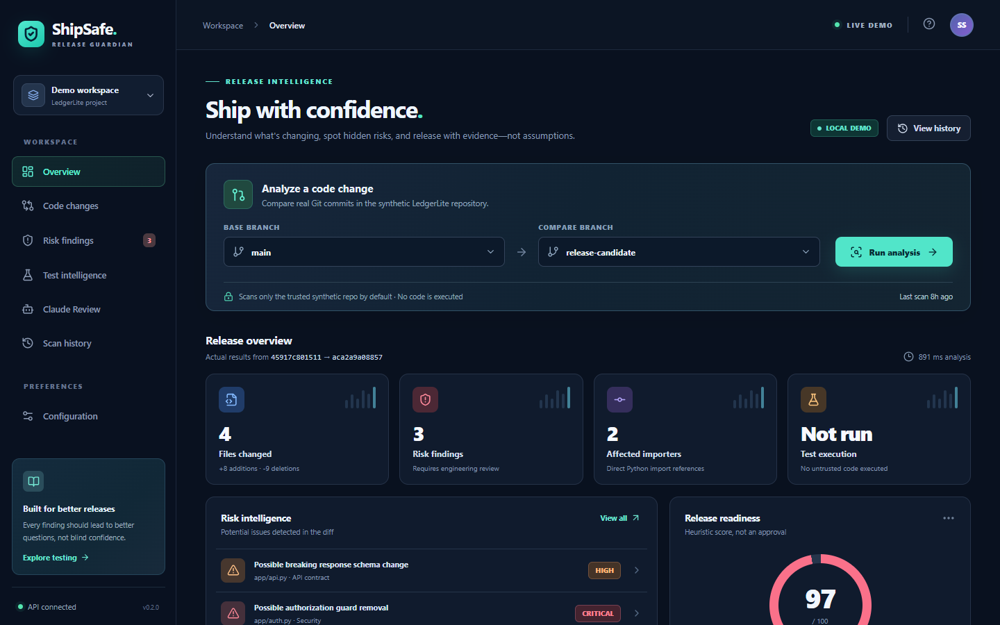
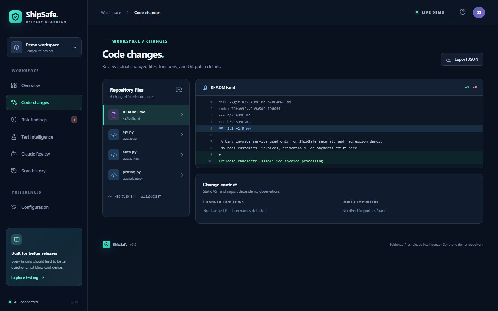
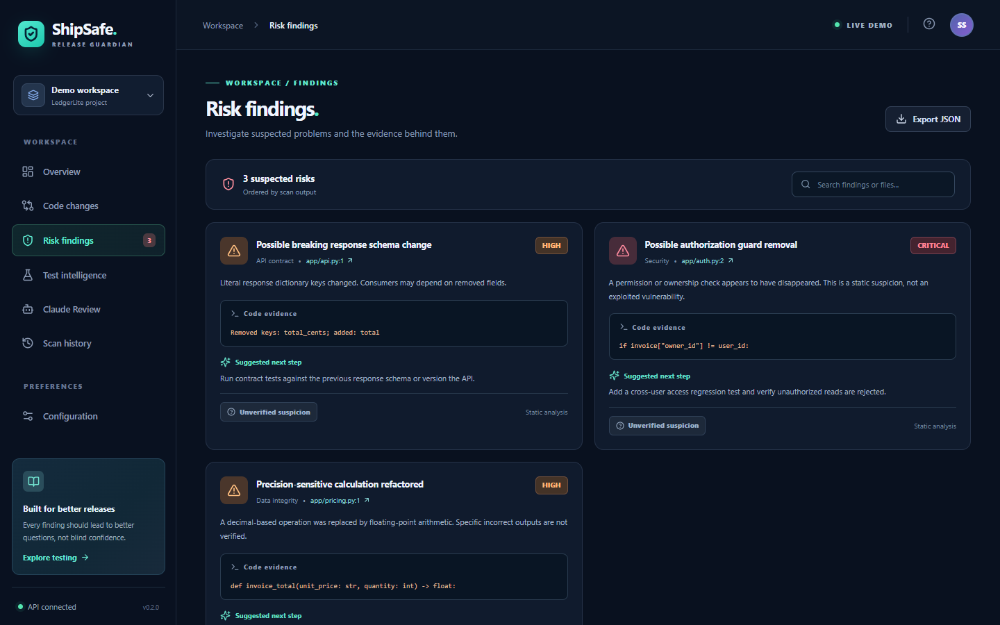
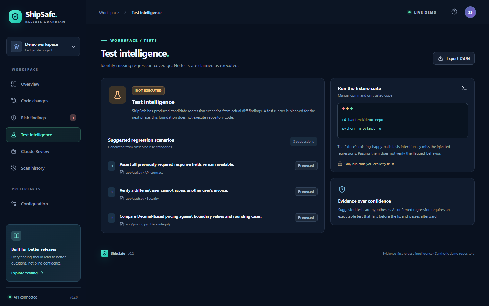
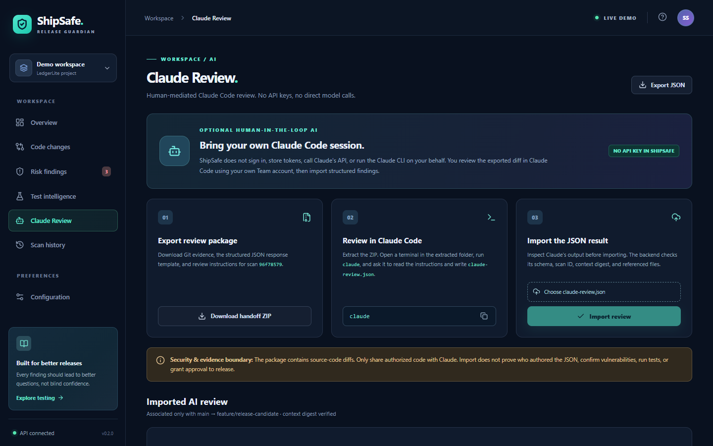
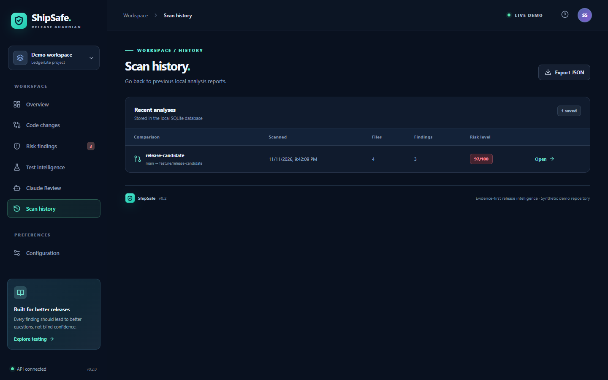
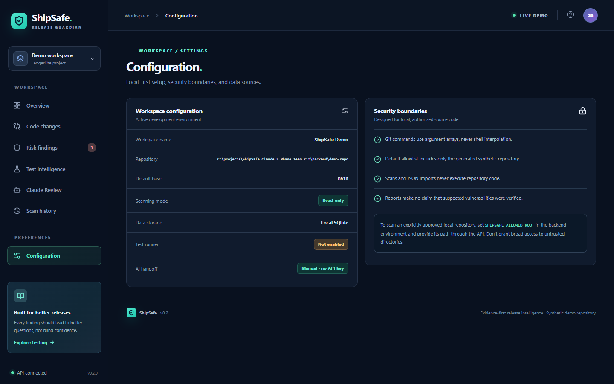
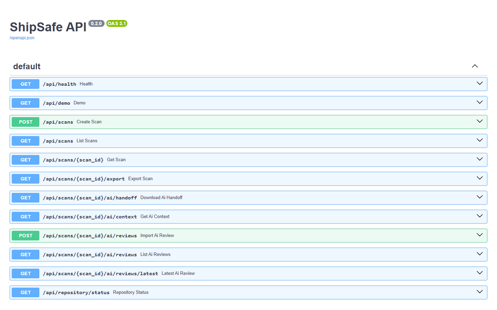

# ShipSafe — Progress Report: Before Phase 1, Added in Phase 1, Still Missing

*Generated 2026-11-12 from branch `feat/p1-foundation` (unreviewed, unmerged). Screenshots were captured from the running app on this machine with the synthetic LedgerLite demo repository. Statuses come from `docs/IMPLEMENTATION_STATUS.md` and an executed test run (`71 passed in 151s`).*

---

## 1. Before Phase 1 — baseline v0.2 (what already existed)

A local-first dashboard: React/TypeScript/Vite frontend, FastAPI backend, real Git diff scanning, Python AST risk heuristics, SQLite scan history, and a manual Claude Code review handoff.

| Feature | Notes |
|---|---|
| Real Git diff scan between two branches | Reads actual commits from a synthetic repo with 6 demo branches |
| Python AST / rule heuristics | 3 rules: auth-guard removal, Decimal→float, removed API response key |
| Risk score, findings, affected importers | Heuristic score, not an approval |
| SQLite scan + AI-review history | Survives restart |
| Claude handoff ZIP export and strict JSON import | No API key; manual, human-mediated |
| Swagger API docs | `http://127.0.0.1:8000/docs` |
| 24 backend tests | Passed at packaging time |
| **Frontend production build** | **Was broken** (TypeScript error TS2550) — see section 2 |

### Overview — scan, risk score, findings


### Code changes — real Git diff viewer


### Risk findings


### Test intelligence — suggested tests (nothing is executed)


### Claude Review — manual handoff (export ZIP → review in Claude Code → import JSON)


### Scan history


### Configuration


### API docs (Swagger)


> The UI looks the same before and after Phase 1 — Phase 1 deliberately did not redesign it. The screenshots above are of the current branch, which preserves every baseline screen.

---

## 2. Added in Phase 1 — foundation (commits `9726a61`, `f8967bc`)

Phase 1 was an audit-and-stabilize phase. Most of it is **backend and documentation, so it has no new screens**.

### Bugs found by execution and fixed (10)

| # | Problem on baseline | Fix |
|---|---|---|
| 1 | Frontend `npm run build` failed (TS2550 `replaceAll`) | Replaced with regex `replace` |
| 2 | A scanned repo's Git config could run a command (`textconv`) during a scan | `--no-textconv` on all diffs |
| 3 | Non-UTF-8 Windows locale crashed scans (cp1252 decode) | Decode as UTF-8 with replacement |
| 4 | Non-ASCII file names produced empty diffs | NUL-separated (`-z`) Git output |
| 5 | Pathological Python source caused HTTP 500 (`RecursionError`) | Guarded parser |
| 6 | NUL byte in `repository_path` caused HTTP 500 | Clean 400 error |
| 7 | Setting `SHIPSAFE_ALLOWED_ROOT` locked out the demo (403) | Demo dir always allowed |
| 8 | Deeply nested review JSON caused HTTP 500 | Mapped to 422 |
| 9 | Unclear "unknown ref" Git message | Readable error message |
| 10 | Interrupted first start left a half-built demo repo forever | Seeder now repairs missing branches |

### New capabilities

| Addition | Where |
|---|---|
| **Provider interfaces** (repository, pull request, change, orchestration) + `LocalGitProvider`; `scan_changes()` seam so Bitbucket can plug in | `backend/app/providers/` |
| **Settings loader** + `.env.example` (`SHIPSAFE_*`, loopback-only) | `backend/app/config.py`, `docs/CONFIGURATION.md` |
| **Forward-only SQLite migration runner** (adopts existing DBs, rolls back on failure, fails closed) | `backend/app/db.py`, `docs/MIGRATIONS.md` |
| **Structured error mapping** (403/400/422 instead of 500s) | `backend/app/errors.py` |
| **Dashboard shows readable API errors** (no more `[object Object]`) | `frontend/src/App.tsx` |
| **`.env` loading in `scripts/dev.py`**, `.env` git-ignored | `scripts/dev.py`, `.gitignore` |
| **Rewritten architecture + implementation-status docs**, Phase 1 handoff | `docs/` |
| **Tests: 24 → 71 passing** (42 new regression/foundation tests + original) | `backend/tests/` |

### Evidence (executed 2026-11-12)
```
cd backend && ../.venv/Scripts/python -m pytest -q
71 passed, 1 warning in 151.07s
```
The frontend dev server and API both started and every dashboard page rendered (screenshots above). `npm run build` was verified in the Phase 1 session; not re-run for this report.

### Honest limits
- Phase 1 is **unreviewed and unmerged**; the acceptance matrix still shows NOT TESTED for Phase 1 gates until the integrator signs off.
- No human UI click-through and no frontend test suite exist yet.

---

## 3. Still not added

| Capability | Status | Planned phase |
|---|---|---|
| Dashboard UI to scan a non-demo repository | NOT IMPLEMENTED (API only) | Phase 2 |
| Pull-request discovery | NOT IMPLEMENTED (interface only) | Phase 2 |
| Bitbucket Cloud repo + PR integration | NOT IMPLEMENTED | Phase 2 |
| Commit-bound PR scans + stale-review detection | NOT IMPLEMENTED | Phase 2 / 3 |
| Per-PR Claude handoff, stale-AI-review warning | NOT IMPLEMENTED | Phase 3 |
| Secure isolated regression test runner | NOT IMPLEMENTED (no repo code is ever executed) | Phase 4 |
| Test patch approval + execution, baseline/head comparison | NOT IMPLEMENTED | Phase 4 |
| Evidence-based release assessment export | NOT IMPLEMENTED | Phase 5 |
| Authentication / roles / multi-user | NOT IMPLEMENTED | Phase 5 assessment |
| Webhooks / CI gating | NOT IMPLEMENTED | Not scheduled |
| Automatic Claude/model invocation | NOT IMPLEMENTED — **by design** | Not planned |
| Truncation warning for large diffs (140 lines/file, 300 files) | PARTIAL | Phase 2 or 5 |
| Rules beyond Python / 3 heuristics | PARTIAL | Phase 5 |

## Summary

| | Before Phase 1 | After Phase 1 | Next |
|---|---|---|---|
| Local scanning + dashboard | Yes | Yes (hardened) | Scan arbitrary repos in UI |
| Frontend build | Broken | Fixed | — |
| Backend tests | 24 | 71 | Frontend tests |
| Bitbucket / PRs | No | Interfaces only | **Phase 2** |
| AI review | Manual import | Same | Phase 3 |
| Run tests safely | No | No | Phase 4 |
